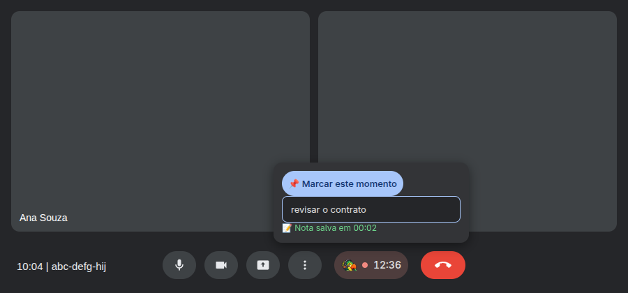
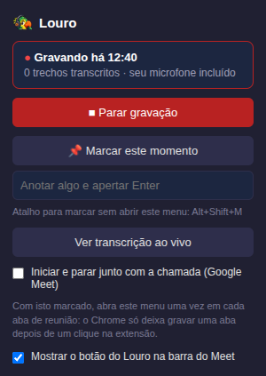
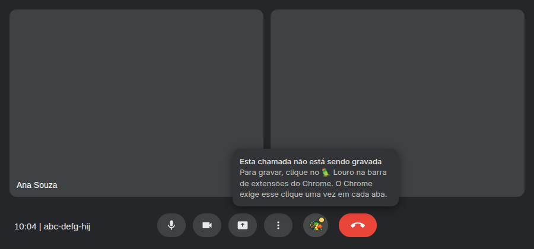

<p align="center">
  
</p>

<h1 align="center">Louro</h1>

<p align="center">
  <b>Local meeting transcription, without the bot in your call.</b>
</p>

<p align="center">
  <a href="https://github.com/rodrigoveneroso/louro/actions/workflows/ci.yml"></a>
  <a href="LICENSE"></a>
</p>

Louro is a Chrome extension and a small Python backend that turn your Google Meet calls
into text files, entirely on your computer. It records the meeting tab and your
microphone, transcribes them with [Whisper](https://github.com/SYSTRAN/faster-whisper)
running locally, and saves one markdown file per meeting, with who said what.

Nobody else in the call sees a bot join. Nothing is uploaded. There is no account and no
API key.

<p align="center">
  
</p>

## No AI inside, on purpose

Louro does not summarise, rewrite or "understand" your meetings, and it never talks to
an AI service. Its job ends at a faithful transcript saved as plain text.

That is the point: the transcripts are yours, in a folder, in a format any tool reads.
Use them later with whatever AI you like (ChatGPT, Claude, a local model) or with none at
all. If you want it automatic, Louro can run a command of yours after every meeting:

```bash
# .env: ask your AI CLI of choice for a summary next to each transcript
LOURO_ON_EXPORT='claude -p "Summarise $LOURO_TRANSCRIPT" > "${LOURO_TRANSCRIPT%.md}.summary.md"'
```

## What you get

- **One markdown file per meeting**, named after the meeting when it was scheduled.
- **Who said what**, read from Meet's own "is speaking" indicators. A line whose speaker
  is unclear stays unnamed rather than getting a wrong name.
- **Your voice too.** The tab only carries the others, so Louro mixes in your microphone,
  with an echo suppressor so you do not need headphones. Muted in Meet means not recorded.
- **Notes.** Type a note from Meet's control bar, the popup or the side panel; it lands in
  the transcript at the minute you took it. Alt+Shift+M marks the minute without a note.
- **Your vocabulary.** Names and jargon you list, plus the participants' names, are handed
  to Whisper so they come out spelled right.
- **Light on your machine.** With the live captions closed, transcription runs in a batch
  every five minutes at low CPU priority, so the call always comes first.
- **No audio kept.** The recording is deleted once transcribed; only text remains.
  Captures under 30 seconds or without speech are dropped.
- **Hands off, if you want.** Recording can start when you join a call and stop when you
  leave, and the button in Meet tells you when a call is *not* being recorded.

## A transcript

What lands in your folder (a made-up meeting; the headings are in Portuguese, like the
interface):

```markdown
# Weekly sync (05/01/2026 10:00)

- sessão: 20260105-100002
- duração: 32:10
- idioma: pt
- status: stopped
- meet: abc-defg-hij
- falantes: estimados pelo indicador de áudio do Google Meet (aproximado)

## Transcrição

[00:04] Ana Souza: Bom dia, vamos começar pelos números do mês.
[00:41] Bruno Lima: O relatório novo ainda está atrasado.
[01:02] 📌 Momento marcado
[01:05] Ana Souza: Então a decisão é corrigir a integração antes de sexta.
[01:12] Combinado.
[01:15] 📝 Nota: Bruno fica com a integração
```

A line without a name means someone spoke but it was not clear who.

## Install

You need Linux, Chrome, and Python 3.10+ (or [uv](https://docs.astral.sh/uv/), which
brings its own). macOS should work with `./start.sh`, untested.

```bash
git clone https://github.com/rodrigoveneroso/louro.git
cd louro
./install.sh
```

The installer asks four questions (meeting language, Whisper model, a folder for the
transcripts, an optional vocabulary file), creates a virtualenv, downloads the model and
sets up a systemd user service that starts the backend at login. No sudo. It is safe to
run again.

Then load the extension: open `chrome://extensions`, turn on **Developer mode**, click
**Load unpacked**, pick the `extension` folder and pin the 🦜.

If anything is off, `./doctor.sh` tells you what and how to fix it.

## Use

1. In the meeting tab, click the 🦜 and **Iniciar gravação** (start recording). The first
   time, Chrome asks for your microphone.
2. During the call, the 🦜 button in Meet's control bar shows the recording time and takes
   notes.
3. Click **Parar gravação** (stop). The transcript is in your folder a few seconds later.

Chrome only lets an extension record a tab after you clicked it in that tab. With
"start and stop with the call" turned on, open the popup once per meeting tab (the lobby
is fine); if you forget, the button in Meet tells you.

<p align="center">
  
  &nbsp;&nbsp;
  
</p>

## Configuration

Settings live in `.env`, which the installer writes. The ones you are most likely to
touch:

| Variable | Default | What it does |
|---|---|---|
| `LOURO_LANGUAGE` | detect | Language of your meetings (`pt`, `en`, ...) |
| `LOURO_MODEL` | `base` | Whisper model: `base` is fast, `small` is more accurate |
| `LOURO_EXPORT_DIR` | off | Folder for the markdown transcripts |
| `LOURO_VOCABULARY_FILE` | off | Names and terms to expect, one per line |
| `LOURO_ON_EXPORT` | off | Command run after each transcript is written |
| `LOURO_FINAL_MODEL` | off | A bigger model that transcribes the whole meeting again after it ends (`large-v3-turbo`) |

Every option is documented in [`.env.example`](.env.example).

## How it works

```
 Meet tab ───┐
             ├─ echo suppressor ─► offscreen recorder ──► WebSocket (1 s chunks)
 Microphone ─┘                       (Chrome extension)          │
                                                                 ▼
 Meet page: who is speaking, meeting name,            local backend (FastAPI)
 participants, joined / left / muted  ──────────────►  ├─ Whisper on the newest window
                                                       ├─ SQLite + live captions
                                                       └─ on stop: speakers, notes,
                                                          markdown, your command
```

Each transcription pass reads only a bounded window of the recording, so the fourth hour
of a meeting costs the same as the first minute.

On a laptop CPU (Ryzen 7 5825U), `small` transcribes 46 seconds of Portuguese speech in
about 10 seconds, so it keeps up live with room to spare. `tools/bench_whisper.py` runs
the same comparison on your machine.

## Privacy and security

The backend listens on `127.0.0.1` only and has no HTTP client, so nothing it handles can
leave your machine. Only the extension can talk to it: web pages are refused by origin
(WebSockets included), DNS rebinding is blocked by a Host check, and request bodies must
be JSON. Each of these has a test. See [SECURITY.md](SECURITY.md) for the threat model and
how to report a vulnerability.

## Development

```bash
.venv/bin/python -m pip install -r requirements-dev.txt
.venv/bin/python -m pytest          # backend, no model download, no network
npm install && npm test             # extension unit tests
npx playwright install chromium
npm run verify                      # real-browser checks (port 8877 must be free: ./stop.sh)
```

The real-browser checks load the extension in Chromium against a throwaway backend:
recording, microphone and echo suppression, reconnecting after a backend restart,
following a stand-in Meet call, the popup, and reloading the extension mid-call. CI runs
everything on every push.

```
extension/   Chrome MV3 extension: popup, offscreen recorder, echo suppressor,
             Meet content scripts and control-bar button, live captions
backend/     FastAPI app, streaming decoder, windowed Whisper, SQLite, speakers,
             vocabulary, markdown export
tests/       pytest suite, extension unit tests, real-browser checks
tools/       Whisper benchmark, icon generator
```

## Credits

Louro started as a fork of [ghostmeet](https://github.com/Higangssh/ghostmeet) by Sanghee
Son, which gave it the extension's capture path, the streaming backend and the
long-meeting design.

[MIT](LICENSE)
