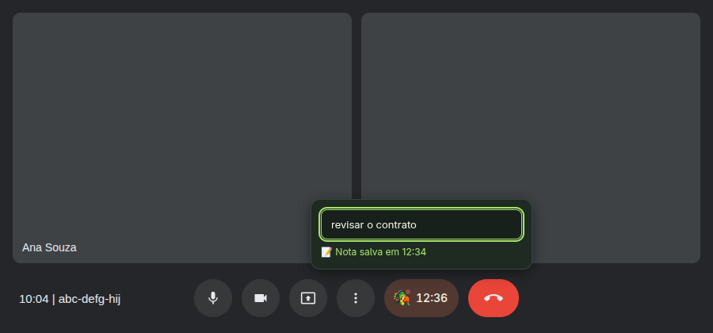
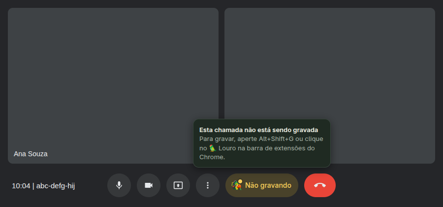
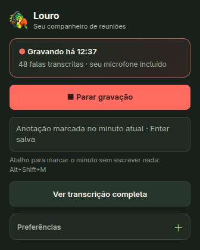
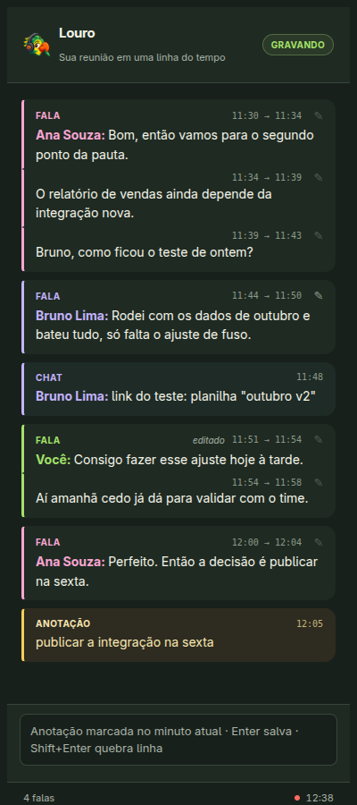

<p align="center">
  
</p>

<h1 align="center">Louro</h1>

<p align="center">
  <b>Transcrição de reuniões local, sem robô na sua chamada.</b>
</p>

<p align="center">
  <a href="https://github.com/rodrigoveneroso/louro/actions/workflows/ci.yml"></a>
  <a href="LICENSE"></a>
</p>

<p align="center">
  <a href="README.md">English</a> · <b>Português</b>
</p>

O Louro é uma extensão do Chrome e um pequeno backend em Python que transformam suas
chamadas do Google Meet em arquivos de texto, tudo no seu computador. Ele grava a aba da
reunião e o seu microfone, transcreve com o [Whisper](https://github.com/SYSTRAN/faster-whisper)
rodando localmente e salva um arquivo markdown por reunião, com quem disse o quê.

Ninguém na chamada vê um robô entrar. Nada é enviado para fora. Não há conta nem chave de
API.

<p align="center">
  
</p>

## Sem IA dentro, de propósito

O Louro não resume, não reescreve nem "entende" suas reuniões, e nunca conversa com um
serviço de IA. O trabalho dele termina numa transcrição fiel, salva como texto simples.

A ideia é essa: as transcrições são suas, numa pasta, num formato que qualquer ferramenta
lê. Use depois com a IA que preferir (ChatGPT, Claude, um modelo local) ou com nenhuma.
Se quiser automático, o Louro pode rodar um comando seu ao fim de cada reunião:

```bash
# .env: pede à CLI de IA da sua escolha um resumo ao lado de cada transcrição
LOURO_ON_EXPORT='claude -p "Resuma $LOURO_TRANSCRIPT" > "${LOURO_TRANSCRIPT%.md}.resumo.md"'
```

## O que você ganha

- **Um arquivo markdown por reunião**, com o nome da reunião quando ela foi agendada.
- **Quem disse o quê**, lido dos próprios indicadores de "está falando" do Meet, uma linha
  por fala: o que alguém disse em sequência é uma linha só, dividida mais ou menos a cada
  minuto num monólogo. Trechos longos são cortados pelo tempo de cada palavra do Whisper,
  para que uma troca rápida não fique toda com uma pessoa. Quando não dá para saber quem
  falou, a linha fica sem nome em vez de ganhar um nome errado.
- **Transcrição ao vivo.** O painel lateral acompanha a reunião enquanto ela é
  transcrita, fala por fala, com o chat e as suas notas na mesma linha do tempo.
- **A sua voz também.** A aba só traz os outros, então o Louro mistura o seu microfone,
  com um supressor de eco para você não precisar de fone. Mudo no Meet é não gravado.
- **Notas.** Escreva uma nota pela barra do Meet, pelo popup ou pelo painel lateral; ela
  entra na transcrição no minuto em que você escreveu. Alt+Shift+M marca o minuto sem nota.
- **O chat da reunião, se quiser.** Ative no popup e as mensagens do chat do Meet são
  salvas com a transcrição, no minuto em que foram enviadas, mesmo com o chat fechado.
- **Corrija o que o Whisper ouviu errado.** Dê dois cliques numa linha do painel lateral
  (ou no ✎) e escreva o certo, durante ou depois da reunião; o markdown segue a correção.
- **O seu vocabulário.** Nomes e jargões que você listar, mais os nomes dos participantes,
  vão para o Whisper para saírem escritos certo.
- **Manias do Whisper, arrumadas.** O markdown deixa de fora o que o Whisper costuma
  inventar: palavras repetidas entre as janelas, uma frase em loop sobre áudio ruim,
  créditos de legenda inventados no silêncio. A transcrição guardada fica como foi
  ouvida, então reexportar aplica regras melhores às reuniões antigas.
- **Leve na sua máquina.** Com a transcrição ao vivo fechada, o Whisper roda em lote a
  cada cinco minutos com baixa prioridade de CPU, então a chamada vem sempre primeiro.
- **Nenhum áudio guardado.** A gravação é apagada depois de transcrita; só o texto fica.
  Gravações com menos de 30 segundos ou sem fala são descartadas.
- **Sem as mãos, se quiser.** A gravação pode começar quando você entra na chamada e
  parar quando sai, e o botão no Meet avisa quando uma chamada *não* está sendo gravada.
  O Chrome ainda exige um gesto por aba: um clique no ícone, ou Alt+Shift+G.

## Uma transcrição

O que chega na sua pasta (uma reunião inventada):

```markdown
# Weekly sync (05/01/2026 10:00)

- sessão: 20260105-100002
- duração: 32:10
- idioma: pt
- status: stopped
- meet: abc-defg-hij
- falantes: estimados pelo indicador de áudio do Google Meet (aproximado)

## Transcrição

[00:04] Ana Souza: Bom dia, vamos começar pelos números do mês. O relatório de vendas ainda depende da integração nova. Bruno, como ficou o teste?
[00:21] Bruno Lima: Rodei com os dados de outubro e bateu tudo, só falta o ajuste de fuso.
[00:27] 💬 Bruno Lima: link do teste: planilha "outubro v2"
[00:30] Você: Consigo fazer esse ajuste hoje à tarde.
[01:02] 📌 Momento marcado
[01:05] Ana Souza: Então a decisão é publicar na sexta.
[01:12] Combinado.
[01:15] 📝 Nota: publicar a integração na sexta
```

Cada linha é uma fala. "Você" é você, pelo microfone; 💬 é o chat da reunião, 📌 e 📝
são as suas marcações e notas. Uma linha sem nome quer dizer que alguém falou, mas não
deu para saber quem.

## Instalação

Você precisa de Linux, Chrome e Python 3.10+ (ou do [uv](https://docs.astral.sh/uv/), que
traz o próprio). No macOS deve funcionar com `./start.sh`, mas não foi testado.

```bash
git clone https://github.com/rodrigoveneroso/louro.git
cd louro
./install.sh
```

O instalador faz quatro perguntas (idioma das reuniões, modelo do Whisper, uma pasta para
as transcrições, um arquivo de vocabulário opcional), cria um virtualenv, baixa o modelo e
configura um serviço systemd de usuário que inicia o backend no login. Sem sudo. Pode
rodar de novo sem problema.

Depois carregue a extensão: abra `chrome://extensions`, ative o **Modo do desenvolvedor**,
clique em **Carregar sem compactação**, escolha a pasta `extension` e fixe o 🦜.

Se algo estiver errado, o `./doctor.sh` diz o quê e como resolver.

## Uso

1. Na aba da reunião, clique no 🦜 e em **Iniciar gravação**, ou aperte Alt+Shift+G. Na
   primeira vez, o Chrome pede acesso ao seu microfone.
2. Durante a chamada, o botão 🦜 na barra do Meet mostra o tempo de gravação e recebe
   notas. **Ver transcrição completa** abre a transcrição ao vivo no painel lateral do
   Chrome; dê dois cliques numa linha para corrigi-la.
3. Clique em **Parar gravação**. A transcrição chega na sua pasta alguns segundos depois.

O Chrome só deixa uma extensão gravar uma aba depois de um clique nela naquela aba. Com
"Iniciar e parar junto com a chamada" ativado, abra o popup uma vez em cada aba de reunião
(pode ser na sala de espera) ou aperte Alt+Shift+G; se esquecer, o botão no Meet avisa.

<p align="center">
  
</p>

<p align="center">
  
  &nbsp;&nbsp;
  
</p>

## Configuração

As configurações ficam no `.env`, que o instalador escreve. As que você mais deve mexer:

| Variável | Padrão | O que faz |
|---|---|---|
| `LOURO_LANGUAGE` | detectar | Idioma das suas reuniões (`pt`, `en`, ...) |
| `LOURO_MODEL` | `base` | Modelo do Whisper: `base` é rápido, `small` é mais preciso |
| `LOURO_EXPORT_DIR` | desligado | Pasta das transcrições em markdown |
| `LOURO_VOCABULARY_FILE` | desligado | Nomes e termos esperados, um por linha |
| `LOURO_ON_EXPORT` | desligado | Comando rodado depois que cada transcrição é escrita |
| `LOURO_FINAL_MODEL` | desligado | Um modelo maior que transcreve a reunião inteira de novo quando ela termina (`large-v3-turbo`) |

Todas as opções estão documentadas no [`.env.example`](.env.example).

## Como funciona

```
 Aba do Meet ┐
             ├─ supressor de eco ─► gravador offscreen ──► WebSocket (blocos de 1 s)
 Microfone ──┘                       (extensão do Chrome)          │
                                                                   ▼
 Página do Meet: quem está falando, nome da reunião,    backend local (FastAPI)
 participantes, chat, entrou / saiu / mudo ─────────►   ├─ Whisper na janela mais recente
                                                        ├─ SQLite + legendas ao vivo
                                                        └─ ao parar: falantes, notas,
                                                           markdown, o seu comando
```

Cada passada de transcrição lê só uma janela limitada da gravação, então a quarta hora de
uma reunião custa o mesmo que o primeiro minuto.

Num notebook (Ryzen 7 5825U), o `small` transcreve 46 segundos de fala em português em
cerca de 10 segundos, então acompanha ao vivo com folga. O `tools/bench_whisper.py` faz a
mesma comparação na sua máquina.

## Privacidade e segurança

O backend escuta só em `127.0.0.1` e não tem cliente HTTP, então nada do que ele processa
sai da sua máquina. Só a extensão consegue falar com ele: páginas web são recusadas pela
origem (WebSockets inclusive), DNS rebinding é barrado por uma checagem do Host, e o corpo
das requisições tem que ser JSON. Cada uma dessas proteções tem teste. Veja o
[SECURITY.md](SECURITY.md) para o modelo de ameaças e como reportar uma vulnerabilidade.

## Desenvolvimento

```bash
.venv/bin/python -m pip install -r requirements-dev.txt
.venv/bin/python -m pytest          # backend, sem baixar modelo, sem rede
npm install && npm test             # testes unitários da extensão
npx playwright install chromium
npm run verify                      # testes num navegador real (a porta 8877 precisa estar livre: ./stop.sh)
```

Os testes no navegador carregam a extensão no Chromium com um backend descartável:
gravação, microfone e supressão de eco, reconexão depois de reiniciar o backend, seguir
uma chamada simulada do Meet, ler o chat dela, o popup, corrigir a transcrição ao vivo e
recarregar a extensão no meio da chamada. O CI roda tudo a cada push.

O `node tools/screenshots.mjs` tira de novo os prints acima, da extensão real e com uma
reunião inventada.

```
extension/   extensão Chrome MV3: popup, gravador offscreen, supressor de eco,
             content scripts e botão na barra do Meet, legendas ao vivo
backend/     app FastAPI, decodificador em streaming, Whisper em janelas, SQLite,
             falantes, vocabulário, exportação em markdown
tests/       suíte pytest, testes unitários da extensão, testes no navegador
tools/       benchmark do Whisper, gerador de ícones, prints do README
```

## Créditos

O Louro começou como um fork do [ghostmeet](https://github.com/Higangssh/ghostmeet), de
Sanghee Son, de onde vieram o caminho de captura da extensão, o backend em streaming e o
desenho para reuniões longas.

[MIT](LICENSE)
